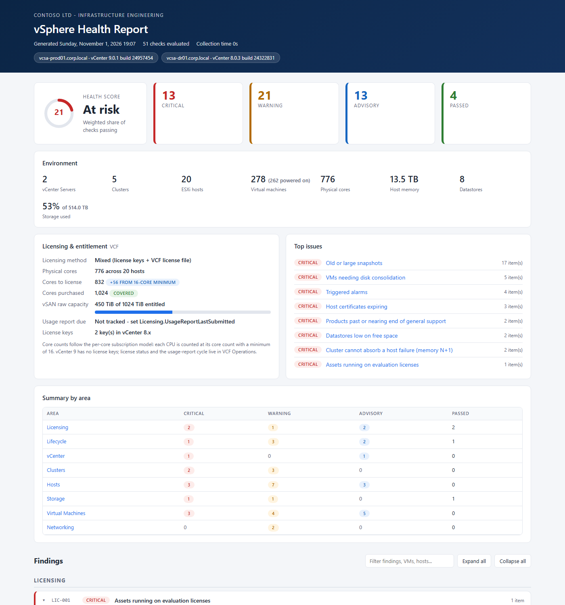
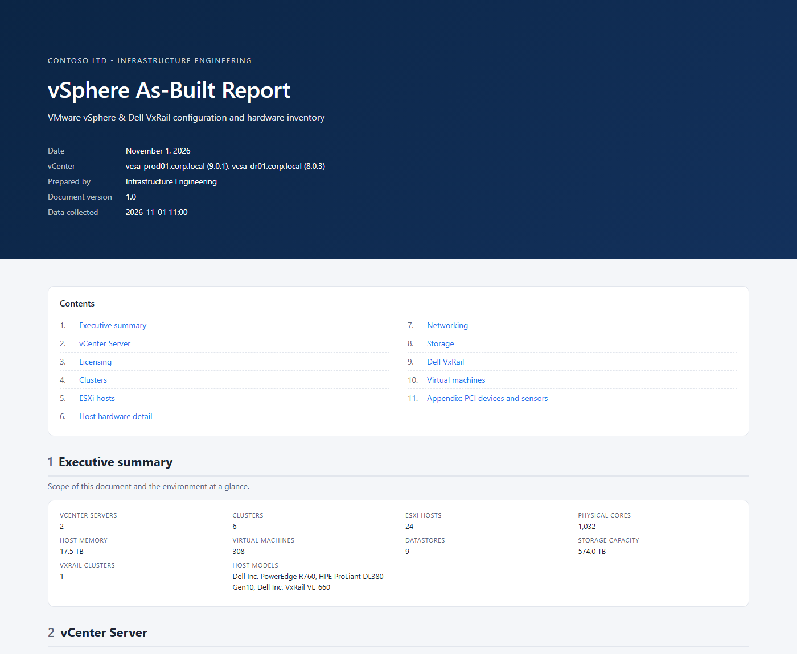
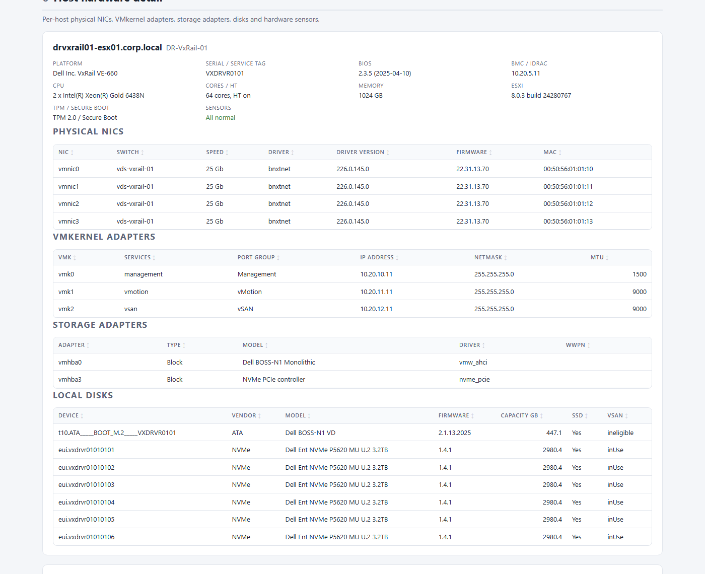
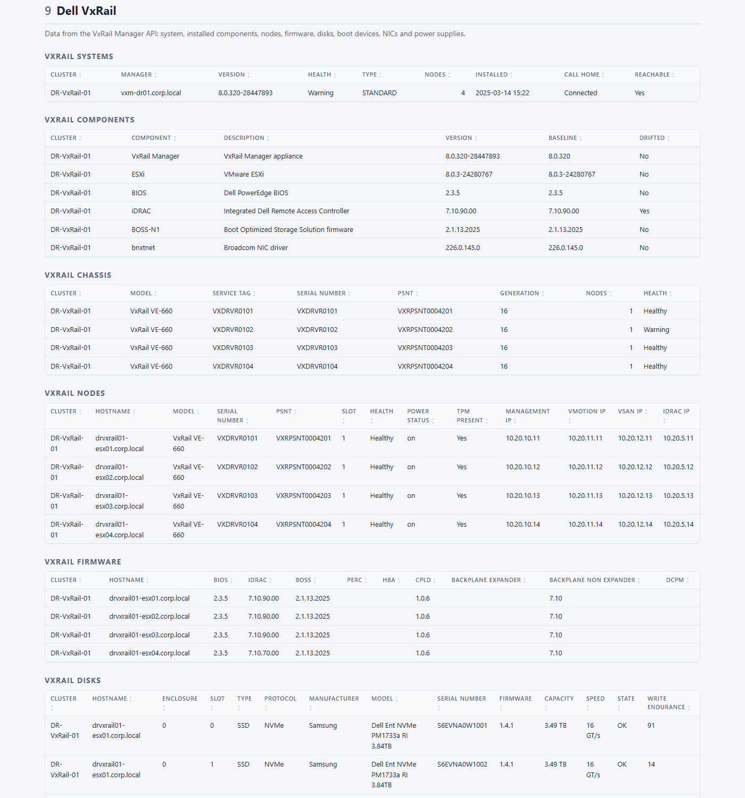

# vSphere Health Report

**Health, compliance, licensing and as-built documentation for VMware vSphere 8, VMware Cloud Foundation (VCF) / vSphere 9, and Dell VxRail 8.**

It produces two reports from one read-only collection pass:

| Report | Use it for | Contents |
|---|---|---|
| **Health report** (daily) | "What needs attention today?" | 65 checks: snapshots, HA/DRS, certificates, datastore space, hardening, hardware faults, firmware drift, VxRail health, vSphere 9 lifecycle blockers, per-core licensing |
| **As-built report** (on demand) | Handover documents, audits, DR runbooks, refresh planning | Cover page, contents, clusters, hosts, **full hardware inventory** (serials, BIOS, NICs with driver/firmware, HBAs/WWPNs, disks, GPUs, sensors), networking, storage, **VxRail nodes, firmware, disks, boot devices, PSUs** and VMs. Prints to PDF; also exports an Excel workbook |



> Try them in a browser: [`docs/sample-report.html`](docs/sample-report.html) (health) and [`docs/sample-asbuilt.html`](docs/sample-asbuilt.html) (as-built), plus [`docs/sample-asbuilt.xlsx`](docs/sample-asbuilt.xlsx). All built from a fictional sample estate.

---

## Why this exists

[vCheck](https://github.com/alanrenouf/vCheck-vSphere) has been the go-to morning report for vSphere admins for over a decade. This project keeps that idea (run it daily, see only what's wrong) and rebuilds it for how vSphere is licensed and run today:

| | vCheck | vSphere Health Report |
|---|---|---|
| **Licensing** | Lists license keys | Per-core subscription math (16-core minimum per CPU), vSAN TiB entitlement (VCF 1 TiB/core, VVF 0.25 TiB/core), vSphere 9 license-file and 180-day usage-report tracking |
| **vSphere 9 readiness** | — | Flags vLCM baselines (removed in 9), Host Profiles, vVols (deprecated in 9), ELM (deprecated in 9), vSAN OSA, end-of-support versions |
| **VxRail** | — | VxRail Manager API: system health, node/disk/PSU/boot-device (BOSS) health, firmware matrix and drift, call home, baseline drift. Lifecycle advice is VxRail-aware |
| **Hardware / as-built** | — | Per-host serial/service tag, BIOS, BMC/iDRAC IP, NIC driver + firmware, VMkernel layout, HBAs/WWPNs, disks, GPUs, sensors; separate as-built document + Excel |
| **Collection** | Each plugin queries vCenter | One property-filtered `Get-View` pass per object type. Checks run on plain objects, so they're fast and testable offline |
| **Output** | HTML | Self-contained HTML (score, KPIs, sortable/filterable tables, dark mode, print-ready) plus CSV per finding, JSON, and an email summary |
| **Severity** | One level per plugin | Critical / Warning / Advisory per row, with a recommended fix for every check |
| **Config** | Variables inside each plugin | One `Settings.psd1` file |
| **Testing** | — | Pester tests and a sample-data mode, so you can try it without a vCenter |

---

## Quick start

### 1. Try it without a vCenter (2 minutes)

```powershell
git clone https://github.com/chadrothermel-dev/vsphere-health-report.git
cd vsphere-health-report
.\Invoke-VsphereHealthReport.ps1 -SampleData .\samples\sample-inventory.json -ConfigPath .\config\Settings.sample.psd1 -Open
```

### 2. Run it against your vCenter

```powershell
# One-time setup
Install-Module VCF.PowerCLI -Scope CurrentUser          # or VMware.PowerCLI 13.x
Copy-Item .\config\Settings.psd1 .\config\Settings.prod.psd1
# Edit Settings.prod.psd1: Connection.Servers, Licensing.Model, Licensing.PurchasedCores

# Run
.\Invoke-VsphereHealthReport.ps1 -ConfigPath .\config\Settings.prod.psd1 -Open
```

Reports are written to `.\reports\vSphereHealth-<timestamp>\`:

```
vSphereHealthReport.html   # the report
csv\_summary.csv           # one row per check
csv\<CheckId>.csv          # rows behind each finding
results.json               # everything, for dashboards / Elastic / Cribl ingestion
```

### 3. Generate an as-built document

```powershell
.\Invoke-VsphereHealthReport.ps1 -ConfigPath .\config\Settings.prod.psd1 -ReportType AsBuilt -Open
# -ReportType Both  -> health report + as-built in one run
```

Output: `vSphereAsBuilt.html` (open it, then **Print > Save as PDF**; it is laid out for A4 landscape with page breaks per section) and `vSphereAsBuilt.xlsx`, with one sheet per table. The workbook needs the `ImportExcel` module (`Install-Module ImportExcel -Scope CurrentUser`); without it you get one CSV per table in `asbuilt-csv\`.



| As-built: host hardware detail | As-built: Dell VxRail section |
|---|---|
|  |  |

### 4. Schedule it (daily at 06:00)

```powershell
# Store the vCenter credential once. It's DPAPI-encrypted, so only this user on this machine can read it.
Get-Credential | Export-Clixml .\config\vcenter.cred.xml
# Set Connection.CredentialFile = '.\config\vcenter.cred.xml' in Settings.prod.psd1

$action  = New-ScheduledTaskAction -Execute 'pwsh.exe' `
    -Argument "-NoProfile -File `"$PWD\Invoke-VsphereHealthReport.ps1`" -ConfigPath `"$PWD\config\Settings.prod.psd1`"" `
    -WorkingDirectory $PWD
$trigger = New-ScheduledTaskTrigger -Daily -At 6am
Register-ScheduledTask -TaskName 'vSphere Health Report' -Action $action -Trigger $trigger -User "$env:USERDOMAIN\$env:USERNAME"
```

> Register the task as the **same account** that created the credential file, or DPAPI won't be able to decrypt it.

---

## Requirements

| Item | Version |
|---|---|
| PowerShell | 7.2+ (recommended) or Windows PowerShell 5.1 |
| PowerCLI | `VCF.PowerCLI` 9.x or `VMware.PowerCLI` 13.x (both provide `VMware.VimAutomation.Core`) |
| vCenter Server | 8.0 (U1–U3) and 9.0 are the targets. 7.0 is collected and checked too, so out-of-support estates get flagged for upgrade (image/ESA detection needs 7.0+/8.0+) |
| vCenter role | **Read-only** at the vCenter root (propagate). Seeing *other users'* sessions (VC-002) also needs `Sessions.TerminateSession`; without it that check just returns fewer rows |
| esxcli (as-built, optional) | NIC driver/firmware versions and the BMC/iDRAC IP come from `Get-EsxCli -V2`, which may need more than read-only on the host [verify in your environment]. Set `AsBuilt.UseEsxcli = $false` to skip it |
| VxRail | VxRail 8.0.x. Uses the VxRail Manager REST API (`https://<vxm>/rest/vxm/v1/...`) with a vCenter SSO account that has a VxRail role. Read-only GET calls only |
| Excel (optional) | `ImportExcel` module for the `.xlsx` as-built workbook |

The script never changes anything in vCenter or VxRail Manager. PowerCLI settings are applied with `-Scope Session` only.

---

## What it checks (65 checks)

<details>
<summary><b>Licensing (7)</b></summary>

| ID | Check | Applies to |
|---|---|---|
| LIC-001 | Assets on evaluation licenses | 8, 9 |
| LIC-002 | License keys expired / expiring | 7, 8 |
| LIC-003 | License keys over capacity | 7, 8 |
| LIC-004 | Core entitlement shortfall (needs `PurchasedCores`) | 8, 9 |
| LIC-005 | vSAN raw TiB above entitlement | 8, 9 |
| LIC-006 | VCF 9 license usage report due (180-day cycle) | 9 |
| LIC-007 | Hosts paying for unused cores (CPUs under 16 cores) | 8, 9 |
</details>

<details>
<summary><b>Lifecycle & vSphere 9 readiness (7)</b></summary>

| ID | Check |
|---|---|
| LCM-001 | vCenter/ESXi past or near end of general support (7.0 ended 2025-10-02) |
| LCM-002 | Mixed ESXi builds in a cluster |
| LCM-003 | Clusters on vLCM **baselines** (removed in vSphere 9; convert to an image first) |
| LCM-004 | Host Profiles in use (move to vSphere Configuration Profiles) |
| LCM-005 | vVols datastores (deprecated in VCF/VVF 9.0) |
| LCM-006 | vSAN OSA clusters (ESA is the strategic architecture) |
| LCM-007 | Enhanced Linked Mode (deprecated in vCenter 9.0) |
</details>

<details>
<summary><b>vCenter & Clusters (7)</b></summary>

VC-001 triggered alarms · VC-002 idle sessions · CL-001 HA disabled · CL-002 admission control disabled · CL-003 DRS not fully automated · CL-004 vCPU:pCore ratio · CL-005 cluster can't absorb a host failure (memory N+1)
</details>

<details>
<summary><b>Hosts (13)</b></summary>

HST-001 disconnected/not responding · HST-002 maintenance mode · HST-003 reboot pending · HST-004 configuration issues · HST-005 SSH/ESXi Shell running · HST-006 lockdown mode disabled · HST-007 NTP · HST-008 remote syslog · HST-009 certificate expiry · HST-010 dead storage paths · HST-011 high CPU/memory · HST-012 TPM 2.0 / Secure Boot · HST-013 overall status not green
</details>

<details>
<summary><b>Hardware (5), from the as-built collection</b></summary>

| ID | Check |
|---|---|
| HW-001 | Firmware/driver drift within a cluster, per host model: BIOS (vCenter), NIC firmware + driver (esxcli), iDRAC/BOSS/PERC/HBA/CPLD/backplane (VxRail Manager) |
| HW-002 | Hardware sensors yellow/red (PSU, fans, temperature, voltage, memory, CPU, storage) |
| HW-003 | Switch uplinks with no link |
| HW-004 | Uplinks on the same switch at different speeds |
| HW-005 | vSAN / vMotion VMkernel MTU differs across a cluster |

These run when hardware data was collected (`-ReportType AsBuilt` or `Both`). On a health-only run they pass silently.
</details>

<details>
<summary><b>Dell VxRail (9)</b></summary>

| ID | Check |
|---|---|
| VXR-001 | VxRail Manager unreachable / API errors |
| VXR-002 | VxRail system health not Healthy |
| VXR-003 | Nodes unhealthy, missing or powered off |
| VXR-004 | Disks failed/missing or low remaining write endurance |
| VXR-005 | Power supplies unhealthy or missing |
| VXR-006 | Boot device (BOSS) unhealthy |
| VXR-007 | NIC ports link down |
| VXR-008 | Call home / Secure Connect Gateway not connected |
| VXR-009 | Installed components drifted from the VxRail baseline |

On VxRail clusters, LCM-002 and LCM-003 point you to **VxRail Manager** for upgrades and vLCM mode instead of the vCenter Updates tab.
</details>

<details>
<summary><b>Storage & Networking (5)</b></summary>

DS-001 low free space · DS-002 over-provisioned · DS-003 inaccessible / maintenance mode · NET-001 promiscuous / forged transmits / MAC changes · NET-002 distributed port groups out of ports
</details>

<details>
<summary><b>Virtual machines (12)</b></summary>

VM-001 old or large snapshots · VM-002 consolidation needed · VM-003 Tools not running · VM-004 Tools out of date · VM-005 old hardware version · VM-006 connected CD/floppy · VM-007 CPU/memory limits · VM-008 reservations · VM-009 orphaned/inaccessible · VM-010 E1000 NICs · VM-011 guest OS mismatch · VM-012 BIOS firmware / no Secure Boot
</details>

List them from PowerShell:

```powershell
Import-Module .\src\VsphereHealth.psd1
Get-VhHealthCheck | Format-Table Id, Severity, Title
```

---

## Licensing: how the numbers are calculated

**Why this matters:** under per-core subscription licensing, you pay for every CPU at its core count, with a minimum of 16 cores per CPU. vSAN is licensed by raw TiB. A host with 2 × 12-core CPUs costs 32 cores, not 24.

| Value | Formula |
|---|---|
| Cores to license (per host) | `sockets × max(16, cores per socket)` |
| vSAN entitlement | `ceil(cores × TiB-per-core) + VsanAddOnTiB`. VCF = 1.0, VVF = 0.25 |
| vSAN usage | Raw capacity of all `vsan` datastores |
| Usage report due (v9) | `UsageReportLastSubmitted + 180 days` |

**vSphere 8 vs 9:**

- **vCenter 8.x**: subscription **license keys** live in vCenter. The tool reads them through `LicenseManager` / `LicenseAssignmentManager` (edition, cost unit, used/total, expiry).
- **vCenter 9.x**: there are **no license keys** in vCenter. Licensing is a single **license file** managed in **VCF Operations**. In disconnected mode, a usage file must be uploaded to Broadcom at least every 180 days. vCenter exposes no public API for that status, so set `Licensing.UsageReportLastSubmitted` and the report tracks the deadline for you.
- Mixed estates (8 and 9 side by side) are reported as *Mixed* and both sets of checks run.

> These are **estimates for planning and audit prep, not a compliance statement**. Confirm against your Broadcom contract and [KB 313548: Counting Cores for VCF and vSphere Foundation and TiBs for vSAN](https://knowledge.broadcom.com/external/article/313548).

---

## Dell VxRail

**Why:** vCenter can't see VxRail-specific hardware state (BOSS health, PSU part numbers, disk slot and wear, iDRAC firmware, PSNT). VxRail Manager can, through its REST API.

**How VxRail Managers are found:**
1. VxRail tags each cluster in vCenter with a custom attribute called `VxRail-IP`. The tool reads it automatically.
2. Override or add managers in settings: `VxRail.Managers = @{ 'Cluster-Name' = 'vxm01.corp.local' }`.

**Calls made (all GET):** `/v1/system`, `/v1/system/cluster-hosts`, `/v1/hosts`, `/v1/chassis`, `/v1/callhome/info`, and `/v1/hosts/{sn}/idrac/network` when `IncludeIdrac` is on. Authentication is HTTP Basic over HTTPS, reusing the vCenter credential unless `VxRail.CredentialFile` is set. TLS 1.2+ only. Certificate checks stay on unless you set `VxRail.SkipCertificateCheck` or `Connection.InvalidCertificateAction = 'Ignore'`.

> **Validate on your first run.** Field names follow Dell's published VxRail public API schema (7.0.x). Dell's 8.0 reference pages could not be retrieved while this was written, so every field is treated as optional. Run once with `-SaveInventory`: the saved `inventory.json` includes the **raw VxRail API responses**, so any field that 8.0 renamed is easy to spot and map.

---

## Configuration

Everything is in [`config/Settings.psd1`](config/Settings.psd1). The settings you're most likely to change:

| Setting | Default | Notes |
|---|---|---|
| `Connection.Servers` | `vcenter01.corp.local` | One or more vCenters (also `-Server`) |
| `Connection.AllLinked` | `$false` | Connect to every vCenter in the ELM domain |
| `Licensing.Model` | `VCF` | `VCF`, `VVF`, `vSphereStandard`, `vSphereEnterprisePlus`, `Perpetual` |
| `Licensing.PurchasedCores` | `0` | Set it to enable the shortfall check |
| `Licensing.UsageReportLastSubmitted` | `''` | vSphere 9: `yyyy-MM-dd` of last usage upload |
| `Thresholds.*` | see file | Snapshot age/size, datastore %, cert days, etc. |
| `Report.Type` | `Health` | `Health`, `AsBuilt` or `Both` (also `-ReportType`) |
| `AsBuilt.UseEsxcli` | `$true` | NIC driver/firmware + BMC IP via esxcli (slower) |
| `AsBuilt.IncludeVmInventory` | `$true` | VM table in the as-built document |
| `VxRail.Enabled` / `Managers` / `CredentialFile` | on / auto / vCenter credential | See [Dell VxRail](#dell-vxrail) |
| `VxRail.DiskEnduranceWarnPct` | `20` | Remaining SSD write endurance warning threshold |
| `Exclusions.VmNamePattern` | `^(vCLS\|VxRail Manager)` | Regex. vCLS agents and the VxRail Manager VM are skipped by default |
| `Lifecycle.*` | 7.0 → 2025-10-02, 8.0 → 2027-10-11 | End of general support. **Verify against the Broadcom lifecycle matrix** |
| `DisabledChecks` | `@()` | e.g. `@('VM-012','HST-006')` |
| `Email.*` | disabled | Inline-styled summary in the body, full report attached |

---

## Adding your own check

Drop a `.ps1` into `src/Checks/`. It's loaded automatically.

```powershell
Register-VhCheck -Id 'CUS-001' -Category 'Virtual Machines' -Severity 'Warning' `
    -Title 'VMs without a backup tag' `
    -Description 'Why this matters, in one or two sentences.' `
    -Remediation 'What to do about it.' `
    -Script {
    param($Inventory, $Settings)
    $Inventory.Vms | Where-Object { $_.Name -like 'p*' -and $_.PowerState -eq 'poweredOn' } | ForEach-Object {
        # Optional per-row Severity (Info | Warning | Critical) overrides the default
        [pscustomobject]@{ vCenter = $_.vCenter; VM = $_.Name; Cluster = $_.Cluster }
    }
}
```

Return nothing and the check passes. Checks only read `$Inventory`, so if you need data that isn't collected yet, add it in `src/Private/Collector.ps1`.

---

## Project layout

```
Invoke-VsphereHealthReport.ps1   entry point
config/Settings.psd1             settings (copy per environment)
src/VsphereHealth.psd1/.psm1     module
src/Private/Collector.ps1        PowerCLI collection -> plain objects
src/Private/Hardware.ps1         per-host as-built hardware (vCenter + optional esxcli)
src/Private/VxRail.ps1           VxRail Manager REST client
src/Private/AsBuilt.ps1          as-built HTML document + Excel/CSV workbook
src/Private/Licensing.ps1        core / vSAN entitlement math
src/Private/Engine.ps1           check registry, runner, health score
src/Private/HtmlReport.ps1       HTML + email rendering
src/Private/Output.ps1           HTML/CSV/JSON export, email
src/Checks/*.ps1                 the checks
samples/                         fictional sample estate + generator
tests/                           Pester tests
```

## Development

```powershell
Invoke-Pester .\tests                                       # 57 tests, no vCenter or VxRail needed
.\samples\New-SampleInventory.ps1 | Set-Content .\samples\sample-inventory.json
.\Invoke-VsphereHealthReport.ps1 -Server vcsa01 -SaveInventory   # capture a real inventory to replay later
```

## Known limitations

- **Not yet validated against live vCenter 9.0 or VxRail 8.0 environments.** VxRail field names come from Dell's published 7.0.x API schema (see [Dell VxRail](#dell-vxrail)). The collector uses documented vSphere API properties, but treat the first run in your lab as a validation run, and please open an issue for anything that comes back empty.
- vSphere 9 license status and usage-report state live in VCF Operations. They're tracked from your settings, not read from an API.
- `ClusterComputeResource.LifecycleManaged` (image vs baselines) and `VsanClusterConfigInfo.VsanEsaEnabled` need vCenter 7.0+ / 8.0+. On older vCenters they report as baseline / OSA.
- Snapshot sizes come from `Get-Snapshot` and are only collected for VMs that have snapshots.
- VxRail Manager reports one node per chassis for most models. For multi-node chassis, nodes are matched to chassis through the chassis `hosts[]` list.
- The as-built HTML prints to PDF from the browser. A Word (.docx) export is not included.
- Email uses `Send-MailMessage` (obsolete but still shipped in PowerShell 7). Swap in MailKit or Microsoft Graph if your mail system requires modern auth.

## Credits

Inspired by [vCheck for vSphere](https://github.com/alanrenouf/vCheck-vSphere) by Alan Renouf and contributors (MIT). VxRail API field mapping was cross-checked against Dell's public VxRail API reference and the [AsBuiltReport.DellEMC.VxRail](https://github.com/AsBuiltReport/AsBuiltReport.DellEMC.VxRail) project. This is a new implementation; no code from either project is reused.

## License

[MIT](LICENSE)
